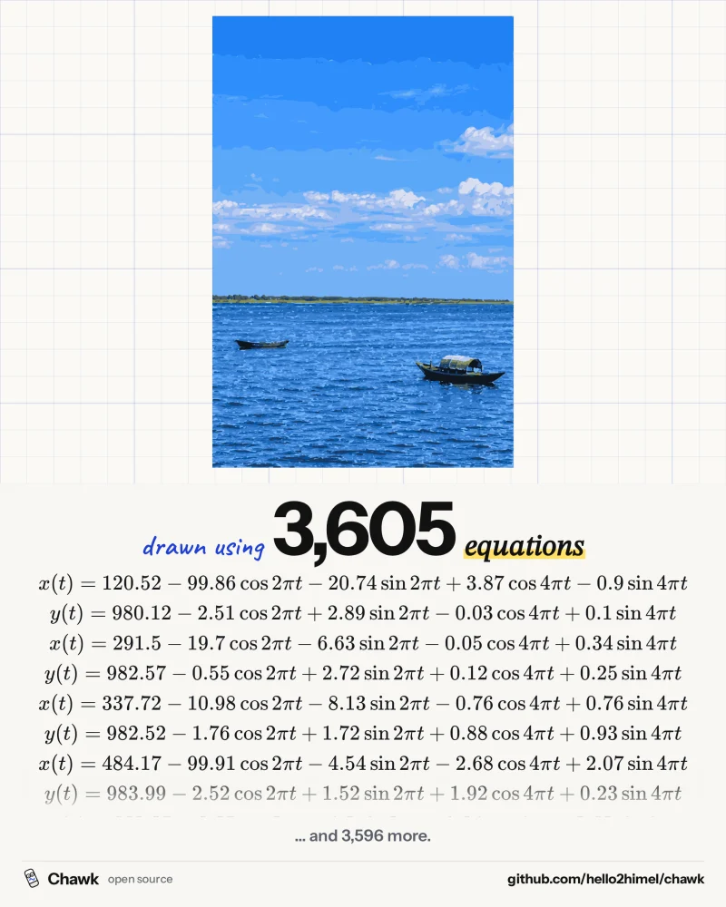
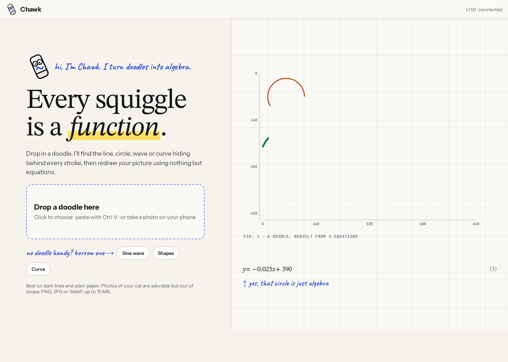
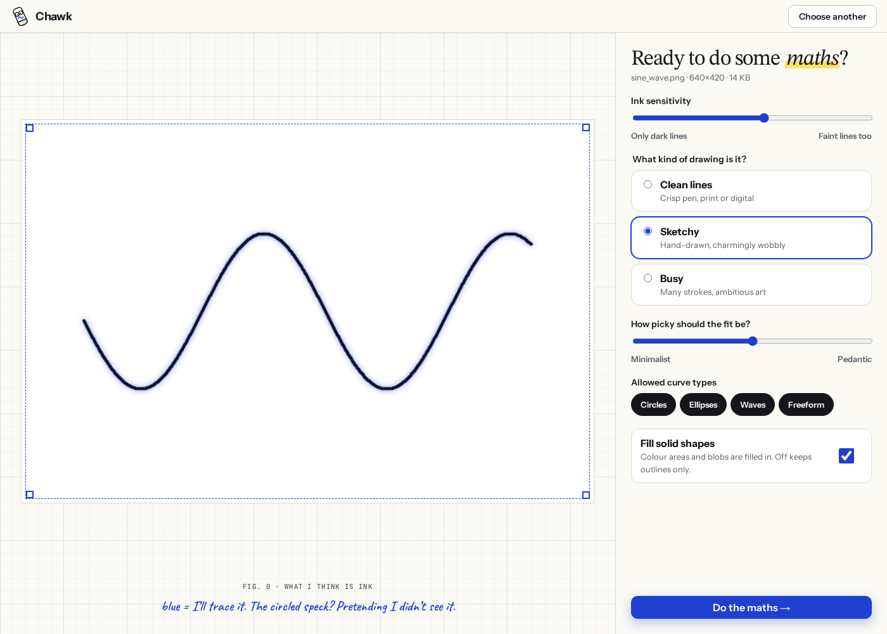
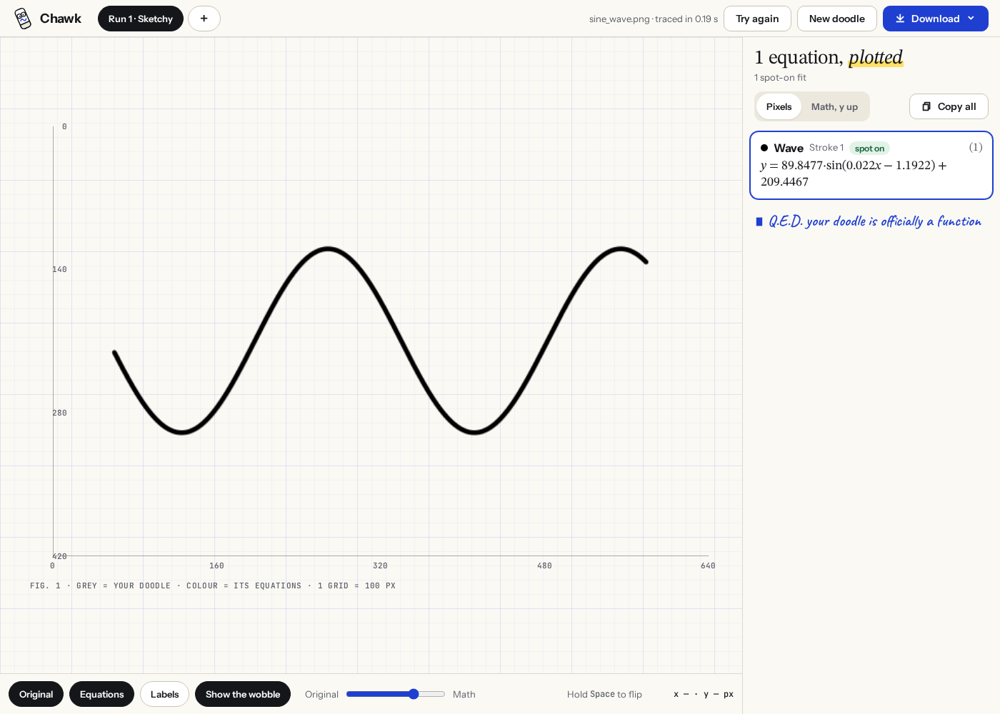

# Chawk

**Every squiggle is a function.**



*A demo poster: the drawing in a 3:2 window, its 3,605 equations below.*

Chawk reads a line drawing (or flat-colour illustration), finds a real equation for
every stroke or region, and redraws the picture using nothing but those equations. It runs on your own machine — no account,
no upload to someone else's server.

| The input | The drawing |
| --- | --- |
|  |  |
| *A photo taken with a camera.* | *The same scene, rebuilt from its equations.* |

## Quick start

### Docker

```bash
docker run --rm -p 8010:8000 ghcr.io/hello2himel/chawk:latest
```

Open **http://localhost:8010**.

Or build it locally:

```bash
docker build -t chawk .
docker run --rm -p 8010:8000 chawk
```

### Static showcase (Netlify)

A self-contained, static portfolio of Chawk lives in [`showcase/`](showcase/README.md). It shows the five proofs, the original-versus-rebuilt compare, the tracing pipeline, and sample equations — with the same light/dark theme system as the app.

- **Netlify Drop:** drag `showcase/` onto <https://app.netlify.com/drop>.
- **Git-connected Netlify:** the checked-in `netlify.toml` publishes `showcase` with no build step.
- **CLI:** `npx netlify-cli deploy --prod --dir=showcase` after `npx netlify-cli login`.

The showcase is precomputed; the full tracer is the Docker app below.

### From source

Python 3.12.

```bash
git clone https://github.com/hello2himel/chawk.git
cd chawk
python -m venv .venv
source .venv/bin/activate
pip install -r requirements.txt
python app.py
```

Open **http://127.0.0.1:8000**.

## How it works

1. **Drop a doodle** — PNG, JPG or WebP up to 15MB, or pick a sample.
2. **Check the ink** — preview what will be traced, pick the drawing type, how
   picky the fit should be, and which curve types are allowed.
3. **Do the maths** — every stroke is fitted.
4. **Inspect** — the drawing is rebuilt from the equations. Hover a curve to
   highlight it, click an equation to pin its card, click again to close it.

| Start | Check |
| --- | --- |
|  |  |



## What it can find

| Model | Looks like | Equation style |
| --- | --- | --- |
| Line | straight strokes | y = mx + b |
| Circle | rings, dots | (x − h)² + (y − k)² = r² |
| Ellipse / arc | ovals, curved segments | rotated conic |
| Polynomial | gentle bends | y = ax³ + bx² + cx + d |
| Wave | sine-like strokes | y = A·sin(Bx + C) + D |
| Freeform spline | everything else | sampled spline |
| Closed curve | filled blobs, colour regions | Fourier series x(t), y(t) |
| Fill | solid letters and shapes | outer contour + holes |

Each equation gets a verdict: **spot on** when it stays close to the ink,
**a bit wobbly** when it is shown anyway with its error noted.

## Downloads

The **Download** menu offers:

- **Drawing + equations** — your drawing with the fitted curves on top.
- **Equations only** — the drawing rebuilt from the math alone.
- **Side by side** — a square 3600×3600 social poster: the drawing rebuilt
  from the equations in a 2:3 window on the left, and "drawn using", the
  count, a legible numbered KaTeX list of the real equations and the project
  footer on the right. It downloads directly.
- **Desmos, LaTeX, text and JSON** — the math, ready for other tools.

The side-by-side poster is a 3600×3600 square (the 1800 design rasterised at
2× for crisp text), composed as DOM + KaTeX. The drawing gets a true 2:3 window (1200×1800); other aspect ratios are fitted inside it, never cropped. The right
column carries "drawn using", the count, a numbered KaTeX list of the actual
equations and the GitHub footer. The list is filled only until the column is
full, and the poster is cached per run.

## Command line

```bash
python lineart2eq.py -i drawing.png -o out.png
python lineart2eq.py -i drawing.png -o out.png --print-equations --json report.json
python lineart2eq.py -i art.png -o out.png --preset precise
```

`python lineart2eq.py --help` lists every knob — thresholding, gap closing,
tolerances, labels, DPI. Exit codes: `0` success, `2` bad input, `3` no strokes.

## HTTP API

```bash
curl -X POST http://127.0.0.1:8000/api/process \
  -F "file=@drawing.png" \
  -F "preset=balanced" \
  -o result.json
```

The response contains `report` (strokes, segments, equations, fit quality and the
settings used) plus base64 PNGs: `image_png_b64`, `image_clean_b64`,
`image_redraw_b64`, `image_redraw_labels_b64`, and optional `debug_png_b64`.

- `GET /health` — liveness check
- `GET /api/presets` — available presets
- `POST /api/process` — `file`, plus optional `preset`, `config` (JSON), `debug`

## Presets

| Preset | Use it for |
| --- | --- |
| `simple` | quick, clean doodles; fewer, simpler equations |
| `balanced` | the default |
| `precise` | technical drawings; follows the ink closely |
| `complex` | busy artwork with many strokes |

Any config field can be overridden, for example
`{"enable_fill": false}` to turn fills off or `{"color_count": 8}` to simplify a
colour illustration.

## FAQ

**It says "no strokes detected" (HTTP 422).**
The image is blank, very low contrast, or a photo/noise. Chawk is for line art;
photos are rejected quickly rather than hanging.

**My dotted line disappeared.**
Dots smaller than `min_component_area` are treated as specks, and gaps wider than
`merge_endpoint_distance` are not joined. Lower the first or raise the second.

**Tiny text or fine detail vanishes.**
Glyphs under about 12px are trimmed as specks. Use a larger image or lower
`min_component_area` / `min_stroke_length`.

**Two nearby lines became one.**
Strokes closer than their own width share a centreline. Leave a little more gap.

**The port is already in use.**
`python app.py --port 8080`

**Docker networking.**
The bundled `docker-compose.yml` uses host networking because this machine cannot
create bridge veth pairs. On a normal Docker host, prefer
`docker run -p 8010:8000 chawk`.

## Development

```bash
python -m unittest discover -s tests -v     # 72 tests
```

| Path | What |
| --- | --- |
| `chawk/` | the pipeline: preprocess → trace → segment/fit → render |
| `app.py` | FastAPI backend and static frontend server |
| `frontend/` | dependency-free web UI |
| `lineart2eq.py` | command-line interface |
| `examples/` | API client and batch-folder script |
| `tests/` | unit and integration tests |

## Limits

- **Photos** are out of scope; Chawk expects ink on paper.
- **Dense sketches** can produce many equations; the `simple` preset keeps the
  count manageable, and the side-by-side sheet shows the first equations that fit.
- **Fills** are on by default; turn them off with `enable_fill: false`.
- Uploads are capped at 15MB, two jobs run at a time, and a trace times out after
  180 seconds.
